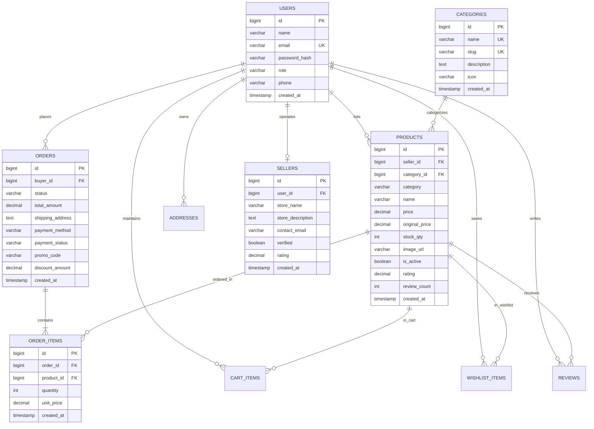
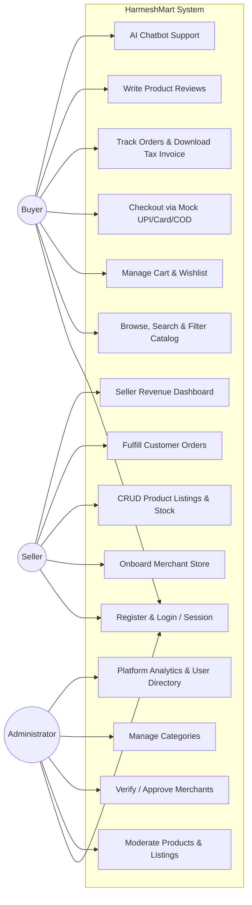
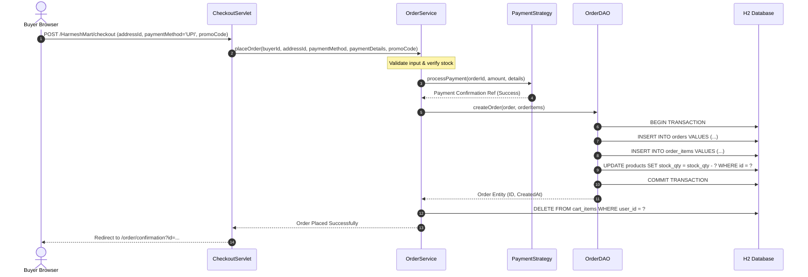

# HarmeshMart — Enterprise Multi-Vendor E-Commerce Platform

[](https://adoptium.net/)
[](https://tomcat.apache.org/)
[](https://tomcat.apache.org/)
[-00557f)](https://www.h2database.com/)
[](https://maven.apache.org/)
[](LICENSE)

An Amazon-inspired, production-grade, multi-vendor e-commerce marketplace web application built with **Java Servlets**, **JSP + JSTL**, **HikariCP connection pooling**, and **H2 Database**. Designed in accordance with Anna University R2025 Semester 3 Project Execution Specifications.

---

## 1. Project Overview & Problem Statement

Independent merchants across India often face severe friction accessing e-commerce marketplaces due to high entry barriers, complicated inventory software, and vendor lock-in. **HarmeshMart** addresses this by providing a lightweight, enterprise-patterned multi-seller platform with:
- Dedicated **Buyer Portal** featuring real-time product search, price/category filters, dynamic cart, wishlist, and simulated checkout.
- High-efficiency **Seller Central** enabling merchant onboarding, real-time inventory management, order fulfillment workflows, and gross revenue metrics.
- Comprehensive **Admin Console** overseeing platform-wide user management, merchant verification, catalog moderation, and revenue auditing.
- Built-in **AI Customer Assistant** delivering intelligent, real-time product guidance and order support.

---

## 2. System Architecture & Design Patterns

The application strictly implements a **Layered MVC Pattern (Front Controller / Per-Resource Servlets)**:

```
[ Browser Client (HTML5 / Bootstrap 5 / Vanilla JS / AJAX Fetch) ]
                              │ HTTP Request
                              ▼
            [ Filter Layer: EncodingFilter, LoggingFilter (SLF4J MDC), AuthFilter ]
                              │
                              ▼
     [ Controller Layer: Servlets (Shop, Product, Cart, Checkout, Auth, etc.) ]
                              │ No SQL, Thin HTTP Orchestration
                              ▼
     [ Service Layer: Business Rules, Validations (ProductService, OrderService) ]
                              │ Depends on DAO Interfaces
                              ▼
        [ DAO Layer: PreparedStatements Only (ProductDAO, OrderDAO, UserDAO) ]
                              │ Atomic Transactions & Resource Cleanup
                              ▼
   [ HikariCP Connection Pool (Owned by Singleton AppContextListener Lifecycle) ]
                              │
                              ▼
            [ H2 Database Engine (Embedded & Server Mode) ]
```

### Applied Design Patterns
1. **DAO Pattern (Data Access Object):** Complete separation between database SQL logic and service layers (`com.harmesh.harmeshmart.dao`).
2. **Singleton Pattern:** Connection pool lifecycle uniquely initialized and destroyed by `AppContextListener`.
3. **Factory Pattern:** `DAOFactory` and `PaymentStrategyFactory` for clean dependency decoupling.
4. **Strategy Pattern:** Swappable mock payment channels (`UpiPaymentStrategy`, `CardPaymentStrategy`, `CodPaymentStrategy`).
5. **Builder / Envelope DTOs:** Strict separation of DTOs (`UserResponseDTO`, `CartSummaryDTO`, `ApiResponse<T>`) avoiding entity leakage.

---

## 3. Required Design Diagrams (Section 5)

### D1: Entity-Relationship (ER) Diagram


---

### D2: Use Case Diagram


---

### D3: Sequence Diagram — Place Order Flow


---

## 4. Technology Stack Specification

| Component | Specification |
|---|---|
| **JDK** | 17 LTS (Eclipse Temurin) |
| **Servlet Container** | Apache Tomcat 9.0.x (Servlet API 4.0.1 `javax.servlet.*`) |
| **Build Tool** | Apache Maven 3.9+ |
| **Database** | H2 Database 2.2.224 (Auto-Server & In-Memory Mode) |
| **Connection Pooling**| HikariCP 4.0.3 (Owned by `AppContextListener`) |
| **View Layer** | JSP 2.3 + JSTL 1.2 + Bootstrap 5 + Vanilla JavaScript (Fetch API) |
| **JSON Serialization**| Google Gson 2.10.1 |
| **Password Hashing** | jBCrypt 0.4 (Work factor 10) |
| **AI Integration** | `ChatProvider` Interface (Mock FAQ Provider + Google Gemini API) |
| **Logging** | SLF4J 1.7 + Logback Classic 1.2 (MDC Request ID) |
| **Testing** | JUnit 5.10 + Mockito 5.5 |

---

## 5. Seed Accounts & Credentials

The database initializes automatically with comprehensive seed records for direct testing:

| Role | Email Address | Password | Description |
|---|---|---|---|
| **Admin** | `admin@harmeshmart.com` | `Admin@12345` | Root platform administrator |
| **Seller** | `apex.electronics@harmeshmart.com` | `Seller@12345` | Apex Tech World (Electronics vendor) |
| **Seller** | `aura.fashion@harmeshmart.com` | `Seller@12345` | Aura Trends India (Fashion vendor) |
| **Seller** | `zenith.home@harmeshmart.com` | `Seller@12345` | Zenith Living & Sports (Home/Fitness vendor) |
| **Buyer** | `buyer@harmeshmart.com` | `Buyer@12345` | Harmesh Kumar (Customer account with pre-seeded orders) |
| **Buyer** | `priya.sharma@example.com` | `Buyer@12345` | Priya Sharma (Customer account) |

*Note: All passwords are stored exclusively as 60-character jBCrypt hashes.*

---

## 6. Build, Deployment & Localhost Run Instructions

### Step 1: Package the Project with Maven
Open PowerShell in the project directory (`c:\Users\h\Downloads\HarmeshMart`):
```powershell
mvn clean package
```
This runs the test suite and generates `target/HarmeshMart.war`.

### Step 2: Deploy to Apache Tomcat
Copy the generated WAR file into your Tomcat `webapps/` folder:
```powershell
Copy-Item target/HarmeshMart.war C:\Users\h\tools\apache-tomcat-9.0.96\webapps\
```

### Step 3: Launch Apache Tomcat
```powershell
& "C:\Users\h\tools\apache-tomcat-9.0.96\bin\startup.bat"
```

### Step 4: Open in Web Browser
Navigate to:
```
http://localhost:8080/HarmeshMart/
```

### Step 5: Verify Health Endpoint
```
http://localhost:8080/HarmeshMart/api/v1/health
```

---

## 7. Deploying to Render.com (Cloud Hosting)

HarmeshMart is fully configured for zero-configuration deployment to [Render.com](https://render.com) using Docker and Render Blueprints.

### Method 1: Automatic 1-Click Blueprint (Recommended)
1. Fork or push this repository to your GitHub account: `harmeshharmesh/harmeshmart`.
2. Log in to [Render Dashboard](https://dashboard.render.com).
3. Click **New +** and select **Blueprint**.
4. Connect your GitHub repository `harmeshmart`.
5. Render detects [`render.yaml`](file:///render.yaml) automatically, provisions a **Docker Web Service** on the **Free Tier**, and configures:
   - Dynamic port binding via `$PORT`
   - In-memory H2 database auto-seeding with INR ₹ catalog
   - Health check endpoint `/api/v1/health`
6. Click **Apply**. Your app will build and go live at `https://harmeshmart.onrender.com/` in ~3–5 minutes!

### Method 2: Manual Web Service Setup on Render
1. Go to **Render Dashboard** -> **New +** -> **Web Service**.
2. Connect repository `harmeshharmesh/harmeshmart`.
3. Fill in the following settings:
   - **Name:** `harmeshmart`
   - **Runtime:** `Docker` *(Do NOT select Node/Python/etc., Java WAR requires Docker)*
   - **Dockerfile Path:** `./Dockerfile`
   - **Instance Type:** `Free`
   - **Health Check Path:** `/api/v1/health`
4. Under **Environment Variables**, add:
   - `DB_URL` = `jdbc:h2:mem:harmeshmart;DB_CLOSE_DELAY=-1`
   - `DB_USERNAME` = `sa`
   - `DB_PASSWORD` = (empty)
   - `AI_CHATBOT_PROVIDER` = `mock` (or `gemini` if providing `GEMINI_API_KEY`)
5. Click **Create Web Service**.

---

## 8. REST API Endpoints (Section 13)

All endpoints conform to Section 13 fixed response envelope standards:
`{ "success": true, "data": { ... }, "error": null }`

- `GET /api/v1/health`: Verifies web container and database connectivity.
- `POST /api/v1/chat`: AI Assistant queries (Rate limited to 10 msgs/min, cached per session).
- `GET /api/v1/cart`: Retrieves real-time shopping cart summary and running totals.
- `POST /api/v1/cart/add`: AJAX item addition.
- `POST /api/v1/cart/update`: AJAX quantity change and running subtotal recalibration.
- `POST /api/v1/wishlist/add`: AJAX wishlist toggle.

---

## 9. Security & Engineering Checklist Compliance

- [x] **PreparedStatement Only:** All database operations strictly parameterized. No string-concatenated SQL queries.
- [x] **Password Protection:** Hashes generated using jBCrypt; cleartext passwords never logged or stored.
- [x] **Session Fixation Defense:** `HttpSession.invalidate()` and session ID regeneration enforced on authentication.
- [x] **RBAC Enforced:** `AuthFilter` protects all `/seller/*`, `/admin/*`, `/checkout/*`, and `/orders/*` paths.
- [x] **Output Escaping:** Strict JSTL `<c:out>` and `fn:escapeXml` preventing Cross-Site Scripting (XSS).
- [x] **Zero Stack Trace Leaks:** Custom 404 and 500 error pages mapped in `web.xml`.
- [x] **Clean Connection Pool:** HikariCP DataSource lifecycle owned by `AppContextListener`.
